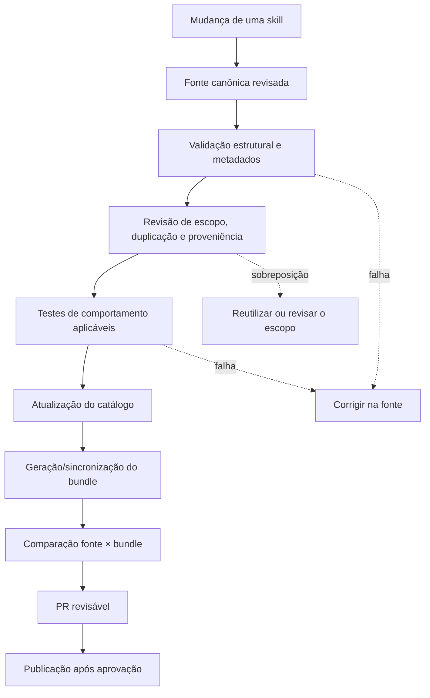

# Arquitetura documental e ADR-0001 — fonte canônica das skills

- Estado: **PROPOSTA — aguardando revisão**
- Data: 2026-10-27
- Escopo: organização dos arquivos, catálogo e bundles de skills deste repositório.
- Restrição: este documento não move, renomeia, cria ou exclui arquivos de skills executáveis.

## Contexto observado

A auditoria do snapshot de `main` `66156930b39c2ad817cacb9d56f94b0625514467` encontrou uma divergência que precisa ser resolvida antes de expandir a biblioteca:

- `AGENTS.md` determina que `.agents/skills/` seja o conteúdo primário; essa pasta não estava presente no tree observado.
- `SKILL_LIBRARY_CATALOG.json` lista 1.500 entradas.
- As 1.374 entradas catalogadas como `origin: new-authored` apontam para arquivos-fonte em `curated-skill-sources/`; as cópias correspondentes do bundle em `plugins/all-skills-collection/skills/` foram encontradas e seus hashes corresponderam no snapshot auditado.
- A árvore contém outros caminhos `SKILL.md`, inclusive fontes externas ou cópias de distribuição. A contagem de caminhos não equivale à contagem de skills únicas.

Esses fatos descrevem o snapshot consultado, não garantem que todos os scripts, workflows ou consumidores usem exatamente o mesmo fluxo em runtime. Nenhuma migração foi executada.

## Diagrama do fluxo proposto

O desenho abaixo é uma **proposta de arquitetura**, não uma afirmação de que todo o pipeline já esteja implementado assim.

## ADR-0001 — fonte canônica de conteúdo e distribuição

### Status

**Proposed**. Não aprovado. Não autoriza mudanças de arquivos, migrações, exclusões, nem alteração de workflows.

### Decisão proposta

1. Tratar cada skill implementada a partir da localização de fonte registrada no catálogo como conteúdo a ser revisado; para as 1.374 entradas autoradas verificadas, a localização encontrada é `curated-skill-sources/`.
2. Tratar `SKILL_LIBRARY_CATALOG.json` como o inventário estrutural para identificar entradas, nomes e caminhos, enquanto sua completude e seus campos continuam sujeitos à validação.
3. Tratar `plugins/all-skills-collection/skills/` como saída de distribuição/bundle para as entradas cuja relação fonte–bundle é declarada pelo catálogo; não editar a cópia de bundle isoladamente.
4. Tratar `.agents/skills/` em `AGENTS.md` como uma instrução conflitante a resolver. Não declarar essa pasta como fonte efetiva enquanto ela estiver ausente no snapshot, nem alterar instruções em `main` antes de confirmar consumidores, scripts e a intenção do mantenedor.
5. Permitir novas candidatas apenas depois de confirmar a localização canônica, o contrato do catálogo, o comportamento dos scripts de sincronização e os testes necessários. Até lá, continuar somente com documentação e auditoria.

### Alternativas consideradas

| Alternativa | Vantagens | Riscos / razão para não adotá-la automaticamente |
|---|---|---|
| Migrar tudo para `.agents/skills/` imediatamente | Alinha a árvore à redação atual de `AGENTS.md` | Pode quebrar caminhos usados pelo catálogo, scripts, bundles ou workflows; grande migração ainda não justificada. |
| Manter `curated-skill-sources/` sem revisar a divergência | Preserva os caminhos existentes e a evidência de correspondência com bundles | Deixa `AGENTS.md` inconsistente e pode induzir futuras contribuições ao local errado. |
| Manter fontes e distribuição em locais distintos, documentados e validados | Dá nomes diferentes a fonte, inventário e saída de pacote | Exige confirmar se os scripts existentes já respeitam este contrato e atualizar a documentação de forma coordenada. |

A terceira alternativa é a recomendação proposta, condicionada à inspeção dos scripts e à aprovação do mantenedor; não é uma decisão final.

### Consequências esperadas se aprovada

- Toda skill implementada terá um caminho-fonte identificável e uma responsabilidade distinta.
- O catálogo poderá ser verificado contra caminhos e hashes, mas não será tratado como prova suficiente de qualidade semântica ou comportamental.
- Bundles serão reconstruíveis e comparáveis à fonte, em vez de serem editados em paralelo.
- Skills provenientes de fontes externas manterão sua procedência e condições de licença registradas.
- O diretório canônico, a regra de atualização do catálogo e o processo de geração do bundle serão documentados juntos.

### Evidências obrigatórias antes da aprovação

- [ ] Ler os scripts reais que escrevem, sincronizam ou validam catálogo e bundles.
- [ ] Localizar referências a `.agents/skills/`, `curated-skill-sources/` e `plugins/all-skills-collection/skills/` em workflows, scripts e documentação.
- [ ] Confirmar se há um consumidor que dependa de `.agents/skills/` ou se a instrução está desatualizada.
- [ ] Executar os validadores apropriados em ambiente local ou CI e registrar comandos, resultados e limitações.
- [ ] Confirmar regras de proveniência/licenciamento para entradas externas.
- [ ] Obter revisão explícita da decisão antes de migrar arquivos ou alterar a instrução normativa.

### Rollback

Como esta ADR é apenas documental, sua rejeição consiste em atualizar o status e registrar a alternativa escolhida. Não há rollback de arquivos de skill porque nenhum foi movido ou alterado por esta proposta.

## Limites desta auditoria

A comparação de caminhos e hashes prova apenas que os blobs comparados eram idênticos no snapshot examinado. Ela não prova que os conteúdos estão corretos, livres de duplicação semântica, licenciados adequadamente, instaláveis ou comportamentalmente testados. Nenhuma dessas verificações é marcada como concluída neste documento.
